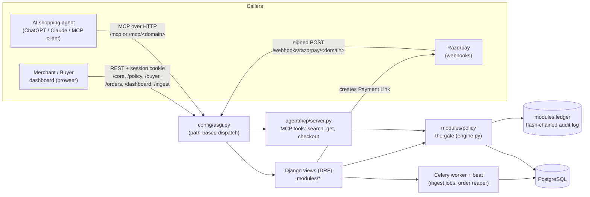
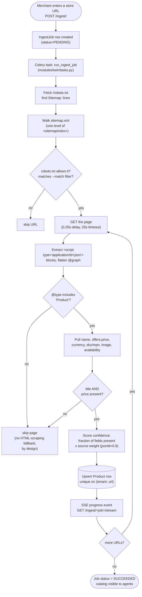
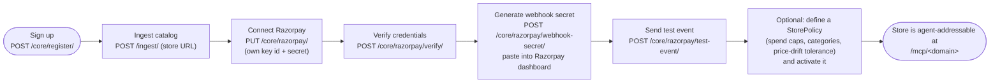
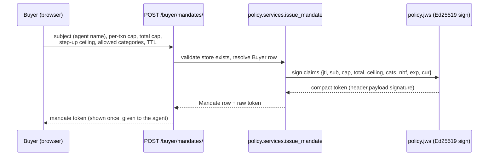
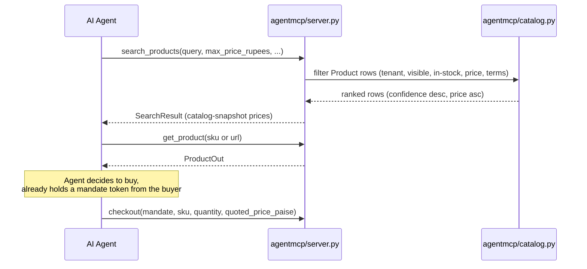
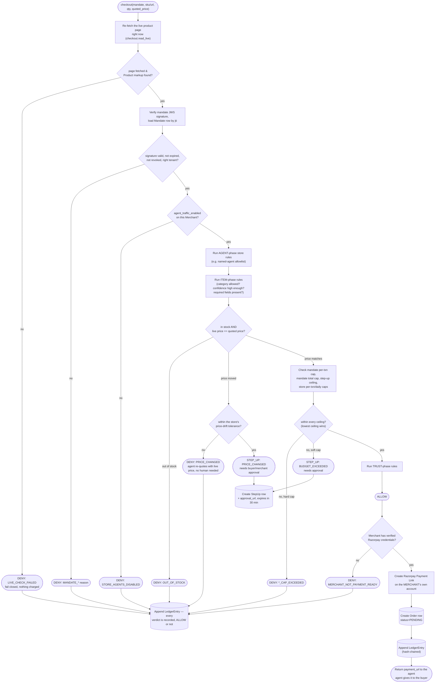
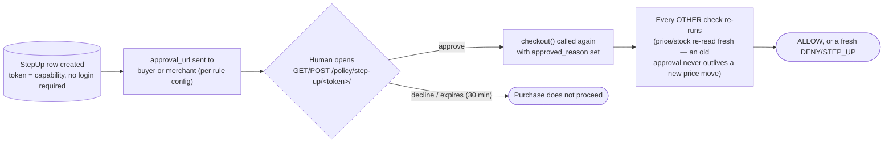

# Munim

**Munim** is a Django backend that lets AI shopping agents (ChatGPT, Claude, or any
MCP-speaking client) browse a merchant's product catalog and complete a purchase
directly on the merchant's own Razorpay account — inside a spending mandate the
buyer signs, and inside spending/behaviour limits the merchant configures. Every
decision (allowed, refused, or escalated to a human) is written to an
append-only, hash-chained ledger.

Munim never touches the money itself. A checkout produces a Razorpay Payment
Link on the *merchant's* account; funds settle directly to the merchant. Munim
is the trust layer in between: it proves who is buying, what they're allowed to
spend, and that the price the agent quoted is the price on the live page right
now.

> Product name across the code/docs is **Munim** (`agentmcp/server.py`'s MCP
> server id, `Merchant.mcp_url`, `SPECTACULAR_SETTINGS["TITLE"]`). `pyproject.toml`
> still carries a placeholder package name (`certifier-reloaded`) from the
> project template — that's cosmetic and safe to rename.

---

## 1. Architecture at a glance

One ASGI process serves two completely different protocols on one port, split
by path in [`config/asgi.py`](config/asgi.py):



**Stack:** Django 6 + Django REST Framework, PostgreSQL, Redis/Celery (async
catalog ingestion + a periodic order-expiry task), the official `mcp` SDK for
the agent-facing server, PyNaCl (Ed25519) for signed spending mandates,
`cryptography` (Fernet) for encrypting merchant payment credentials at rest.

---

## 2. User roles

Roles are stored on `User.user_role` (`modules/core/choices.py`) and, for
authorization, derived from *what rows a user owns* rather than the role field
alone — see the note under Merchant below.

| Role | Who they are | How they're identified | What they can do |
|---|---|---|---|
| **Admin** | Platform operator | `UserRoleChoices.ADMIN` / Django `is_staff` / `is_superuser` | Django admin site (`/admin/`) — merchants, mandates, policies, ledger, webhook hit log, everything. No dedicated API surface; this is operational access, not a product role. |
| **Merchant** | An onboarded store owner | Owns a `Merchant` row (`user.get_merchant()`) — gated by `IsMerchantPermission`, keyed on the row existing, *not* on `user_role`, so the two can never disagree about what a handler is allowed to resolve | Ingest/manage their catalog, connect & verify Razorpay, configure the webhook, define spending/behaviour **policies**, flip the agent-traffic kill switch, approve merchant-side step-ups, view orders/revenue/agent-traffic dashboards, view the audit ledger. |
| **Buyer** | A human who deploys a shopping agent | Default role on signup (`UserRoleChoices.BUYER`); a `Buyer` row is created/adopted on first use (`Buyer.for_user`) | Issue and revoke **mandates** (signed spending authority for one agent at one store), issue/revoke **platform API keys** (for the cross-merchant `/mcp` door), approve buyer-side step-ups, view their own orders. |
| **Agent** *(not a login)* | The LLM / MCP client itself | A bearer platform API key (cross-merchant door) or nothing at all (merchant-scoped door, public by design) + a mandate token passed as a tool argument | Search catalogs, read products, call `checkout` — **never** authenticates as a Django user. It acts *on behalf of* a Buyer, constrained by the mandate the Buyer handed it. |

Two doors onto the same MCP tools, both handled by one dispatcher in `asgi.py`:

- **`/mcp/<domain>`** — a merchant's own storefront door. Publicly reachable
  (that's the point — it's the store's own surface), hard-locked to that one
  merchant. No API key needed to *search*; `checkout` still requires a valid
  buyer mandate.
- **`/mcp`** (bare) — the platform-wide door. Requires
  `Authorization: Bearer munim_sk_...` (issued via `POST /core/api-keys/`),
  and can search/compare across every onboarded merchant (`search_all_merchants`,
  `list_merchants`).

---

## 3. Product fetching (catalog ingestion)

Munim does not ask a merchant to integrate an API. It reads the same
structured data every e-commerce platform already publishes for Google
Shopping SEO: `schema.org/Product` JSON-LD embedded in each product page.



Key properties:

- **Tiered by design, one tier implemented.** `modules/twin/ingest.py` documents
  a `feed` tier (Google/Meta product feed) for later; today only the `jsonld`
  tier runs. There is **deliberately no HTML-scraping fallback** — a
  page without `Product` markup is skipped, not guessed at.
- **`confidence` matters downstream.** A thin or badly-tagged row gets a low
  score; the policy engine can be configured to force low-confidence rows
  through a human step-up before an agent can buy them (`LOW_CONFIDENCE_ROW`).
- **The catalog is a snapshot, never the truth at checkout.** `search_products`
  and `get_product` return the price captured at ingest time. `checkout`
  always re-fetches the live page first (`checkout.read_live`) and fails
  closed if the page can't be re-read — the catalog is for *browsing*, the
  live page is for *charging*.
- **Manual catalog rows** are also supported (`POST /ingest/products`) for a
  merchant who wants to hand-add or correct a product without a full re-crawl.
- Progress streams to the merchant's dashboard live over Server-Sent Events
  (`modules/twin/views_stream.py`), so a long crawl doesn't leave the UI
  guessing.

---

## 4. How a purchase actually works

### 4.1 Merchant onboarding



A store is transactable the moment it has a domain and Razorpay credentials —
policies are optional. With **no active policy**, the engine still enforces
everything that isn't a configurable rule: the per-merchant kill switch
(`agent_traffic_enabled`), the mandate's own signed spending ceilings,
catalog membership ("we don't sell what we don't list"), live stock, and an
exact live-price match.

### 4.2 Buyer issues a mandate

A **Mandate** is a signed (Ed25519 / JWS) capability the buyer hands to their
own agent — never to Munim's database as the source of truth for limits, only
as verified claims read at decision time:



The buyer copies that token into their agent's config/prompt. The signature
means the agent **cannot raise its own spending cap** — the caps live inside
signed bytes it cannot forge, and the row in Postgres only tracks the mutable
state a signature can't carry: revocation and accumulated spend.

### 4.3 The agent shops



### 4.4 Checkout — the policy gate

This is the only path where money can move, and it's deliberately
deterministic — **no model in the money path**:



Two independent ceilings are always in force, and **the lower one wins**:
the buyer's mandate (what *this agent* may spend) and the store's policy
(what *any* agent may do here). `checkout()` never charges anything by
itself — it only ever creates a Payment Link; a human still has to pay it.

### 4.5 Payment confirmation (webhook)

```mermaid
sequenceDiagram
    participant Buyer
    participant Razorpay
    participant Webhook as POST /webhooks/razorpay/&lt;domain&gt;
    Buyer->>Razorpay: opens payment_url, pays
    Razorpay->>Webhook: payment_link.paid (HMAC-signed with the merchant's own webhook secret)
    Webhook->>Webhook: verify signature, dedupe on x-razorpay-event-id
    Webhook->>Webhook: Order -> PAID, Mandate.spent_paise += amount
    Webhook->>Webhook: Append LedgerEntry (payment_confirmed)
```

Mandate spend is only ever debited **here**, on confirmed payment — not at
`ALLOW` time — so an abandoned Payment Link never eats into a buyer's budget.
A Celery beat task (`modules.recovery.tasks.expire_stale_orders`, every 5
minutes) reaps orders whose link expired without ever being paid.

### 4.6 Step-up approval (human in the loop)

Some breaches don't get a flat refusal — they park the purchase for a human:



---

## 5. The audit ledger

`modules/ledger/models.py` — every policy decision, ALLOW or DENY, is
appended to a per-merchant, hash-chained log:

```
entry.chain_hash = sha256(prev.chain_hash + canonical({seq, action, decision, reason_code, detail}))
```

Editing any historical row breaks every hash after it. `LedgerEntry.verify(tenant)`
recomputes the whole chain and reports the first break, if any — exposed as
the audit trail behind `/audit/`. A refusal you can't show an auditor isn't a
control, so denials are recorded exactly like approvals.

---

## 6. Data model cheat sheet

| Model | Module | Purpose |
|---|---|---|
| `User` / `Buyer` | `modules.core` | Django auth user; a lightweight `Buyer` identity (email-adopted, not tied 1:1 at signup) that mandates and orders hang off. |
| `Merchant` | `modules.core` | The tenant. Owns encrypted Razorpay credentials, the agent-traffic kill switch, its own domain (`mcp_url` / `webhook_url` derive from it). |
| `PlatformAPIKey` | `modules.core` | A buyer's key for the cross-merchant `/mcp` door (`munim_sk_...`, hash stored, shown once). |
| `Product` | `modules.twin` | One catalog row: price/stock/confidence snapshot, `is_visible_to_agents` toggle. |
| `IngestJob` | `modules.twin` | One async crawl run; drives the SSE progress stream. |
| `Order` | `modules.twin` | Read-projection of a purchase (ledger is the source of truth for money) — status, amounts, which agent placed it. |
| `Event` / `WebhookHit` | `modules.twin` | Idempotent Razorpay event log / a hit log of every webhook POST regardless of outcome. |
| `Mandate` | `modules.policy` | Signed (JWS) buyer authority: caps, allowed categories, validity window, accumulated spend. |
| `StorePolicy` / `PolicyRule` | `modules.policy` | A merchant's named rule set (at most one active); each `PolicyRule` is one configurable check (`registry.py`) in `DRAFT` or `ENFORCING` state, with an `on_breach` of refuse / ask-buyer / ask-merchant. |
| `StepUp` | `modules.policy` | A parked purchase awaiting human approval, addressed by an unguessable token. |
| `LedgerEntry` | `modules.ledger` | Append-only, hash-chained decision log. |

---

## 7. API surface (by prefix)

| Prefix | Audience | Covers |
|---|---|---|
| `/mcp`, `/mcp/<domain>` | AI agents | `ping`, `search_products`, `get_product`, `list_merchants`, `search_all_merchants`, `checkout` |
| `/core/` | Everyone / merchant | Register, login, Google OAuth, platform API keys, Razorpay account setup & verification, merchant/category dropdowns |
| `/ingest/` | Merchant | Start a catalog crawl, list/edit products, SSE progress stream |
| `/policy/` | Merchant | Policies & rules CRUD, activate/deactivate, kill switch, rule catalog, merchant-side step-up approval, decision history |
| `/buyer/` | Buyer | Issue / list / revoke mandates |
| `/orders/` | Merchant | Order list, tiles/counts summary, CSV export, order detail |
| `/dashboard/` | Merchant | Revenue, agent-traffic, catalog-read, and policy analytics widgets |
| `/audit/` | Merchant | The ledger / chain verification |
| `/webhooks/razorpay/<domain>` | Razorpay | Signed payment events |
| `/api/schema/swagger-ui/` | Everyone | Live OpenAPI docs (drf-spectacular) |
| `/admin/` | Admin | Django admin |

---

## 8. Project layout

```
config/          settings, ASGI dispatch (Django ⟷ MCP), Celery app, URLs
agentmcp/        the MCP server: tools, auth, catalog reads, checkout orchestration
base/            shared model/view/permission/pagination/field plumbing
modules/
  core/          User, Merchant, Buyer, PlatformAPIKey, auth, Razorpay account setup
  twin/          catalog ingestion, products, orders, webhooks, dashboards, SSE
  policy/        mandates (JWS), store policies/rules, the decision engine, step-ups
  ledger/        the hash-chained audit log
  recovery/      Celery beat task(s) — e.g. expiring stale orders
payments/        Razorpay API client (payment links)
tests/           pytest suite (policy engine, checkout, mandates, webhooks, MCP tools...)
```

---

## 9. Running it

### Docker (recommended)

```bash
cp .env.example .env        # fill in PUBLIC_HOST at minimum
python manage.py field_keygen      # -> MUNIM_FIELD_ENCRYPTION_KEYS
python manage.py mandate_keygen    # -> MUNIM_MANDATE_KEYS
docker compose -f docker/nonprod/docker-compose.yml up
```

This starts Postgres, Redis, the Django/ASGI app (`web`), a Celery `worker`,
and Celery `beat`. Then, inside the `web` container:

```bash
python manage.py migrate
python manage.py createsuperuser
```

### Locally with `uv`

```bash
uv sync
export DATABASE_URL=postgres://... REDIS_URL=redis://... PUBLIC_HOST=localhost:8000 ...
python manage.py migrate
uvicorn config.asgi:application --reload
```

### Useful management commands

| Command | Purpose |
|---|---|
| `field_keygen` | Generate a Fernet key for encrypted Merchant credential columns |
| `mandate_keygen` | Generate an Ed25519 keypair for signing mandates |
| `ingest --source https://store.example [--match /product] [--limit N]` | Run a catalog crawl from the CLI, without going through the dashboard |
| `issue_mandate` | Issue a mandate from the CLI (useful for scripting/demos without the buyer UI) |

### Tests

```bash
pytest
```

Covers the policy engine, checkout gating, mandate issuance/JWS, catalog
reads/scoping, order lifecycle, ledger hash-chain integrity, Razorpay webhook
tenancy/signature handling, and the MCP tool dispatch layer (dual-door
scoping, read counting).
